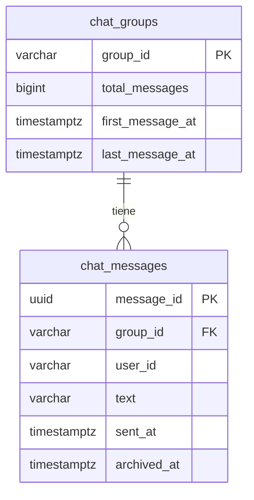

# Stream-Chat

Chat grupal en tiempo real con RabbitMQ y Apache Kafka, microservicios Java 17 / Spring Boot, PostgreSQL y Docker Compose.

Este README crece con cada fase; el diagrama y el guion de la demostración se completan en la fase 10.

## Levantar el proyecto

```bash
cp .env.example .env
docker compose up -d --build
docker compose ps
```

Abre `http://localhost` en dos navegadores, entra con nombres distintos al mismo grupo y escribe.

## Pruebas unitarias

Cada servicio es un proyecto Maven independiente:

```bash
cd backend/chat_api && mvn test
```

| Servicio | Pruebas |
|---|---|
| chat_api | 81 |
| chat_backend | 100 |
| audit_bridge | 38 |
| analytics_service | 48 |
| typing_api | 70 |
| typing_processor | 112 (State, Strategy con Factory, Observer, adaptadores y señal de envío) |
| status_backend | 82 |

## Verificación por fase

### Fase 1 — chat_api

```bash
curl -i -X POST http://localhost/message -H "Content-Type: application/json" -d '{"user":"Ana","group":"GrupoA","text":"Hola"}'
curl -i -X POST http://localhost/message -H "Content-Type: application/json" -d '{"user":"","group":"GrupoA","text":""}'
curl -i -X POST http://localhost/message -H "Content-Type: application/json" -d '{"user":"Ana","group":"GrupoZ","text":"Hola"}'
```

Se espera `202`, `400` con detalle por campo y `404`.

### Fase 3 — audit_bridge (Kafka `message_audit_log`)

```bash
docker exec streamchat_kafka kafka-console-consumer --bootstrap-server localhost:9092 --topic message_audit_log --from-beginning --property print.key=true --timeout-ms 5000
```

Cada línea muestra la clave (el grupo) y el JSON del mensaje.

### Fase 4 — analytics_service (PostgreSQL)

```bash
docker compose logs analytics_service | grep "Mensajes totales"
```

En Git Bash o Linux:

```bash
docker exec streamchat_postgres sh -c 'psql -U "$POSTGRES_USER" -d "$POSTGRES_DB" -c "SELECT * FROM chat_groups"'
```

En `cmd` de Windows (no entiende las comillas simples):

```bash
docker exec streamchat_postgres sh -c "psql -U $POSTGRES_USER -d $POSTGRES_DB -c 'SELECT * FROM chat_groups'"
```

`infra/postgres/init.sql` solo se ejecuta cuando el volumen `pgdata` está vacío. Si el volumen ya existía, aplícalo a mano:

```bash
docker exec -i streamchat_postgres sh -c 'psql -U "$POSTGRES_USER" -d "$POSTGRES_DB"' < infra/postgres/init.sql
```

Modelo de datos (pata de gallo):



### Fase 5 — typing_api (Kafka `typing_events`)

```bash
curl -i -X POST http://localhost/typing -H "Content-Type: application/json" -d '{"user":"Ana","group":"GrupoA"}'
curl -i -X POST http://localhost/typing -H "Content-Type: application/json" -d '{"user":"","group":"GrupoA"}'
curl -i -X POST http://localhost/typing -H "Content-Type: application/json" -d '{"user":"Ana","group":"GrupoZ"}'
docker exec streamchat_kafka kafka-console-consumer --bootstrap-server localhost:9092 --topic typing_events --from-beginning --property print.key=true --property print.partition=true --timeout-ms 6000
```

Se espera `202` sin cuerpo, `400` con detalle por campo, `404`, y en Kafka cada evento con su clave (el grupo). Los eventos de tecleo se borran a los 5 minutos (`retention.ms=300000`).

### Fase 6 — typing_processor (debounce y `status_updates`)

Un fanout sin colas descarta los mensajes, así que hasta que exista `status_backend` se comprueba con una cola temporal (en Git Bash):

```bash
docker exec streamchat_rabbitmq sh -c 'rabbitmqadmin -u "$RABBITMQ_DEFAULT_USER" -p "$RABBITMQ_DEFAULT_PASS" declare exchange name=status_updates type=fanout durable=true'
docker exec streamchat_rabbitmq sh -c 'rabbitmqadmin -u "$RABBITMQ_DEFAULT_USER" -p "$RABBITMQ_DEFAULT_PASS" declare queue name=prueba.status durable=false'
docker exec streamchat_rabbitmq sh -c 'rabbitmqadmin -u "$RABBITMQ_DEFAULT_USER" -p "$RABBITMQ_DEFAULT_PASS" declare binding source=status_updates destination=prueba.status'
for i in 1 2 3 4 5 6 7 8 9 10; do curl -s -o /dev/null -X POST http://localhost/typing -H "Content-Type: application/json" -d '{"user":"Ana","group":"GrupoA"}'; done
sleep 6
docker exec streamchat_rabbitmq sh -c 'rabbitmqadmin -u "$RABBITMQ_DEFAULT_USER" -p "$RABBITMQ_DEFAULT_PASS" get queue=prueba.status count=20 ackmode=ack_requeue_false'
docker logs streamchat_typing_processor 2>&1 | grep Debounce
docker exec streamchat_rabbitmq sh -c 'rabbitmqadmin -u "$RABBITMQ_DEFAULT_USER" -p "$RABBITMQ_DEFAULT_PASS" delete queue name=prueba.status'
```

Se espera un solo `TYPING` y un solo `STOPPED` de Ana aunque se enviaron 10 eventos, y en el log `Debounce: N eventos -> M transiciones`.

### Fase 7 — status_backend e indicador "está escribiendo…"

1. Abre `http://localhost` en dos ventanas y entra al mismo grupo con nombres distintos (por ejemplo Ana y Luis).
2. Arriba deben verse en verde "Mensajes: conectado" y "Estado: conectado".
3. Escribe en la ventana de Ana sin enviar: en la de Luis aparece "Ana está escribiendo…" con tres puntos animados.
4. Deja de escribir: unos 4 segundos después el indicador desaparece.
5. Escribe y presiona Enter: el indicador desaparece de inmediato. Si Ana vuelve a teclear, aparece otra vez.
6. Una tercera ventana en otro grupo no ve el indicador.

```bash
docker logs streamchat_typing_processor 2>&1 | grep Debounce
docker logs streamchat_status_backend 2>&1 | grep "entregado a"
```

`docker compose down` conserva los datos; `docker compose down -v` borra los volúmenes y la próxima vez `init.sql` corre solo.

### Fase 8 — Integración y evidencia

Los comandos están escritos para Git Bash o Linux.

#### Bots y panel de evidencia

1. Abre `http://localhost`, entra a un grupo y mira la columna derecha (en pantallas angostas queda debajo del chat).
2. En "Bots" elige la cantidad (1, 2, 3 o 5) y pulsa "Activar bots". Cada bot teclea letra por letra con `POST /typing` cada 70–260 ms, a veces hace una pausa de 1,5 a 6 s (más larga que la ventana de 4 s, así que también genera `STOPPED` por inactividad), envía la frase con `POST /message` y descansa de 2,5 a 9 s antes de la siguiente.
3. "Detener bots" cancela todas sus esperas al instante. Lo que ya estaba en camino termina y, a los 4 s, llegan los últimos `STOPPED`.
4. El "Panel de evidencia" muestra:
   - eventos de tecleo enviados por esta ventana (respuestas `202` de `POST /typing`; los fallos se cuentan aparte);
   - transiciones `TYPING` y `STOPPED` recibidas por `/ws/status` de los usuarios de esta ventana (tú y tus bots);
   - eventos por transición: el efecto del debounce (en la prueba, 527 eventos → 44 transiciones, unos 12 por transición);
   - mensajes enviados, y abajo el total de transiciones de todo el grupo.
5. "Reiniciar" pone los contadores en cero.

Deja visible la pestaña de los bots: los navegadores frenan los temporizadores de las pestañas en segundo plano.

#### 8a. Arranque desde cero con un solo comando

```bash
docker compose down -v
docker compose up -d --build
docker compose ps
docker logs streamchat_kafka_init 2>&1 | grep PartitionCount
docker exec streamchat_postgres sh -c 'psql -U "$POSTGRES_USER" -d "$POSTGRES_DB" -c "\dt"'
```

Se esperan 16 contenedores `(healthy)`, `streamchat_kafka_init` en `Exited (0)`, los dos topics con 3 particiones y las tablas `chat_groups` y `chat_messages`, creadas por `init.sql`. La primera vez, con la construcción de las imágenes, tarda unos 10 minutos; con las imágenes ya construidas, unos 3.

#### 8b. Los dos flujos de extremo a extremo

Abre dos ventanas en GrupoA (Ana y Luis) y escribe desde la de Ana. Luis ve "Ana está escribiendo…", que desaparece a los ~4 s o al enviar, y recibe el mensaje. Después comprueba la otra punta:

```bash
docker exec streamchat_kafka kafka-console-consumer --bootstrap-server localhost:9092 --topic message_audit_log --from-beginning --property print.key=true --property print.partition=true --timeout-ms 6000
docker exec streamchat_postgres sh -c 'psql -U "$POSTGRES_USER" -d "$POSTGRES_DB" -c "SELECT * FROM chat_groups"'
docker compose logs analytics_service | grep "Mensajes totales"
docker logs streamchat_typing_processor 2>&1 | grep Debounce | tail -3
```

#### 8c. Matar una réplica de chat_api y medir el reparto

Reparto con 60 mensajes (cuenta cuántos confirmó cada réplica):

```bash
for c in streamchat-chat_api-1 streamchat-chat_api-2; do echo "$c $(docker logs $c 2>&1 | grep -c 'confirmado por RabbitMQ')"; done
for i in $(seq 1 60); do curl -s -o /dev/null -w "%{http_code}\n" -X POST http://localhost/message -H "Content-Type: application/json" -d "{\"user\":\"Carga\",\"group\":\"GrupoA\",\"text\":\"reparto $i\"}"; done | sort | uniq -c
for c in streamchat-chat_api-1 streamchat-chat_api-2; do echo "$c $(docker logs $c 2>&1 | grep -c 'confirmado por RabbitMQ')"; done
```

La diferencia entre el antes y el después de cada réplica es lo que atendió (en la prueba: 28 y 32).

Caída de una réplica en medio del envío (con `chat.html` abierto en GrupoA para ver llegar los mensajes):

```bash
for i in $(seq 1 100); do curl -s -o /dev/null -w "%{http_code}\n" -X POST http://localhost/message -H "Content-Type: application/json" -d "{\"user\":\"Carga\",\"group\":\"GrupoA\",\"text\":\"caida $i\"}"; sleep 0.1; done | sort | uniq -c &
sleep 4; docker kill streamchat-chat_api-1; wait
docker compose up -d chat_api
```

Se esperan 100 respuestas `202` y los 100 mensajes en orden en el navegador. Nginx reintenta en la réplica viva; una o dos peticiones pueden tardar hasta 5 s mientras el gateway descarta la IP muerta (`resolver ... valid=5s`). `docker kill` cuenta como parada manual y Docker no la reinicia: `docker compose up -d chat_api` la recupera.

#### 8d. Caída de los brokers

Kafka detenido: el mensaje espera en `audit_bridge.messages` y llega al volver.

```bash
docker stop streamchat_kafka
curl -s -X POST http://localhost/message -H "Content-Type: application/json" -d '{"user":"Ana","group":"GrupoA","text":"Con Kafka caido"}'
docker exec streamchat_rabbitmq rabbitmqctl -q list_queues name messages_ready messages_unacknowledged consumers
docker start streamchat_kafka
```

Mientras Kafka está detenido, la cola muestra el mensaje (listo o sin confirmar) y el chat sigue respondiendo `202`. Unos 30 s después de arrancar Kafka la cola queda en 0, y el mensaje aparece en `message_audit_log` y en `chat_messages`.

RabbitMQ detenido: `typing_processor` descarta las transiciones con un aviso y no se cae.

```bash
docker stop streamchat_rabbitmq
for i in 1 2 3 4 5; do curl -s -o /dev/null -X POST http://localhost/typing -H "Content-Type: application/json" -d '{"user":"Ana","group":"GrupoA"}'; done
docker logs --since 1m streamchat_typing_processor 2>&1 | grep descartada
docker ps --filter name=typing_processor
docker start streamchat_rabbitmq
```

Al volver RabbitMQ todos los servicios se reconectan solos (sin reinicios) y los dos flujos funcionan de nuevo.

#### 8e. Aislamiento entre grupos

Con Ana y Luis en GrupoA, abre una tercera ventana en GrupoB y activa los bots en GrupoA: la ventana de GrupoB no recibe ni mensajes ni el indicador, y su panel queda en 0 transiciones.

#### 8f. Límites y usuario sin privilegios

```bash
docker stats --no-stream
for c in $(docker compose ps -q chat_api typing_api chat_backend typing_processor status_backend audit_bridge analytics_service); do echo "$(docker inspect -f '{{.Name}}' $c) $(docker exec $c whoami)"; done
docker top streamchat-chat_api-1 -o uid,user,pid,comm
docker exec streamchat-chat_api-1 id
```

`whoami` debe responder `appuser` en las 11 réplicas. `docker top` muestra el UID 100 con el nombre que ese número tiene en el host (en Docker Desktop sale `_rpc`); `docker exec ... id` confirma que dentro del contenedor el UID 100 es `appuser` y no root (UID 0).

#### 8g. Perfil prod

```bash
docker compose down -v
SPRING_ACTIVE_PROFILE=prod docker compose up -d
docker logs streamchat-analytics_service-1 2>&1 | grep -E "profile is active|Started"
```

Con `prod`, `analytics_service` usa `ddl-auto=validate`: Hibernate no crea tablas, solo comprueba que las de `init.sql` coincidan con las entidades. Si una columna no coincide, el servicio no arranca (`Schema-validation: missing column ...`). Para volver a `dev`: `docker compose up -d`.

#### Primer tecleo después de reiniciar typing_api

Antes, cada réplica de `typing_api` creaba su productor Kafka con la primera petición: esa tecla llegaba a Kafka 2,6–3,3 s tarde, el navegador recibía `504` y, como `typing_processor` mide la ventana desde `occurredAt`, el indicador solo se veía 0,3–1,5 s.

Ahora `KafkaTypingEventPublisher` prepara el productor al arrancar (`SmartInitializingSingleton`, antes de que Tomcat abra el puerto 8080) y `spring.mvc.servlet.load-on-startup=1` inicializa Spring MVC al arrancar. Compruébalo en el log de cada réplica: "Productor Kafka listo antes de recibir tráfico" debe aparecer antes de "Tomcat started on port 8080".

```bash
docker compose up -d --build typing_api
docker logs streamchat-typing_api-1 2>&1 | grep -E "Productor Kafka listo|No se pudo preparar|Tomcat started"
```

Medido después del cambio, con cada réplica recién reiniciada: la primera tecla responde `202` en ~2 s, llega a Kafka entre 190 y 310 ms después de `occurredAt` y el indicador se ve 3,1–4,3 s. Desde la segunda petición la respuesta tarda milisegundos. Si Kafka está caído al arrancar, el servicio arranca igual con el aviso "No se pudo preparar el productor Kafka" y los eventos se descartan con un aviso en el log, sin error 500.

Opcional antes de una demostración, para que también la primera tecla responda en milisegundos:

```bash
for i in $(seq 1 10); do curl -s -o /dev/null -w "%{http_code} %{time_total}s\n" -m 10 -X POST http://localhost/typing -H "Content-Type: application/json" -d '{"user":"Calentamiento","group":"GrupoC"}'; done
```

## Pruebas manuales con `curl`

### Tildes y signos en Git Bash de Windows

Si el JSON va escrito directamente en el comando y lleva caracteres como `¡`, `¿`, `ñ` o tildes, Git Bash en Windows puede dañar esos caracteres antes de que lleguen a `curl`. El servicio recibe bytes que no son UTF-8 válido y responde:

```json
{ "codigoHttp": 400, "mensaje": "El cuerpo de la solicitud no es un JSON válido." }
```

No es un error del código: el mismo mensaje enviado desde un archivo UTF-8 responde `202` y llega intacto a RabbitMQ (comprobado en la fase 1). Desde el navegador (`chat.html`) no ocurre.

Para probar a mano con tildes, guarda el cuerpo en un archivo UTF-8 y envíalo con `--data-binary`:

```bash
curl -i -X POST http://localhost/message -H "Content-Type: application/json; charset=utf-8" --data-binary @mensaje.json
```

Ejemplo de `mensaje.json`:

```json
{ "user": "Ana", "group": "GrupoA", "text": "¡Hola a todos! ¿Cómo están?" }
```
