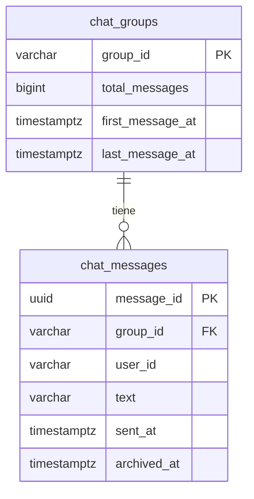

# Stream-Chat

Chat grupal en tiempo real con RabbitMQ y Apache Kafka, microservicios Java 17 / Spring Boot, PostgreSQL y Docker Compose.

Este README crece con cada fase; el diagrama y el guion de la demostración se completan en la fase 10.

## Levantar el proyecto

```bash
cp .env.example .env
docker compose up -d --build
docker compose ps
```

Abre `http://localhost` en dos navegadores, entra con nombres distintos al mismo grupo y escribe.

## Pruebas unitarias

Cada servicio es un proyecto Maven independiente:

```bash
cd backend/chat_api && mvn test
```

| Servicio | Pruebas |
|---|---|
| chat_api | dominio, servicio y adaptador RabbitMQ |
| chat_backend | dominio, servicio, listener y WebSocket |
| audit_bridge | 38 |
| analytics_service | 48 |
| typing_api | 65 |
| typing_processor | 96 (State, Strategy con Factory, Observer y adaptadores) |

## Verificación por fase

### Fase 1 — chat_api

```bash
curl -i -X POST http://localhost/message -H "Content-Type: application/json" -d '{"user":"Ana","group":"GrupoA","text":"Hola"}'
curl -i -X POST http://localhost/message -H "Content-Type: application/json" -d '{"user":"","group":"GrupoA","text":""}'
curl -i -X POST http://localhost/message -H "Content-Type: application/json" -d '{"user":"Ana","group":"GrupoZ","text":"Hola"}'
```

Se espera `202`, `400` con detalle por campo y `404`.

### Fase 3 — audit_bridge (Kafka `message_audit_log`)

```bash
docker exec streamchat_kafka kafka-console-consumer --bootstrap-server localhost:9092 --topic message_audit_log --from-beginning --property print.key=true --timeout-ms 5000
```

Cada línea muestra la clave (el grupo) y el JSON del mensaje.

### Fase 4 — analytics_service (PostgreSQL)

```bash
docker compose logs analytics_service | grep "Mensajes totales"
```

En Git Bash o Linux:

```bash
docker exec streamchat_postgres sh -c 'psql -U "$POSTGRES_USER" -d "$POSTGRES_DB" -c "SELECT * FROM chat_groups"'
```

En `cmd` de Windows (no entiende las comillas simples):

```bash
docker exec streamchat_postgres sh -c "psql -U $POSTGRES_USER -d $POSTGRES_DB -c 'SELECT * FROM chat_groups'"
```

`infra/postgres/init.sql` solo se ejecuta cuando el volumen `pgdata` está vacío. Si el volumen ya existía, aplícalo a mano:

```bash
docker exec -i streamchat_postgres sh -c 'psql -U "$POSTGRES_USER" -d "$POSTGRES_DB"' < infra/postgres/init.sql
```

Modelo de datos (pata de gallo):



### Fase 5 — typing_api (Kafka `typing_events`)

```bash
curl -i -X POST http://localhost/typing -H "Content-Type: application/json" -d '{"user":"Ana","group":"GrupoA"}'
curl -i -X POST http://localhost/typing -H "Content-Type: application/json" -d '{"user":"","group":"GrupoA"}'
curl -i -X POST http://localhost/typing -H "Content-Type: application/json" -d '{"user":"Ana","group":"GrupoZ"}'
docker exec streamchat_kafka kafka-console-consumer --bootstrap-server localhost:9092 --topic typing_events --from-beginning --property print.key=true --property print.partition=true --timeout-ms 6000
```

Se espera `202` sin cuerpo, `400` con detalle por campo, `404`, y en Kafka cada evento con su clave (el grupo). Los eventos de tecleo se borran a los 5 minutos (`retention.ms=300000`).

### Fase 6 — typing_processor (debounce y `status_updates`)

Un fanout sin colas descarta los mensajes, así que hasta que exista `status_backend` se comprueba con una cola temporal (en Git Bash):

```bash
docker exec streamchat_rabbitmq sh -c 'rabbitmqadmin -u "$RABBITMQ_DEFAULT_USER" -p "$RABBITMQ_DEFAULT_PASS" declare exchange name=status_updates type=fanout durable=true'
docker exec streamchat_rabbitmq sh -c 'rabbitmqadmin -u "$RABBITMQ_DEFAULT_USER" -p "$RABBITMQ_DEFAULT_PASS" declare queue name=prueba.status durable=false'
docker exec streamchat_rabbitmq sh -c 'rabbitmqadmin -u "$RABBITMQ_DEFAULT_USER" -p "$RABBITMQ_DEFAULT_PASS" declare binding source=status_updates destination=prueba.status'
for i in 1 2 3 4 5 6 7 8 9 10; do curl -s -o /dev/null -X POST http://localhost/typing -H "Content-Type: application/json" -d '{"user":"Ana","group":"GrupoA"}'; done
sleep 6
docker exec streamchat_rabbitmq sh -c 'rabbitmqadmin -u "$RABBITMQ_DEFAULT_USER" -p "$RABBITMQ_DEFAULT_PASS" get queue=prueba.status count=20 ackmode=ack_requeue_false'
docker logs streamchat_typing_processor 2>&1 | grep Debounce
docker exec streamchat_rabbitmq sh -c 'rabbitmqadmin -u "$RABBITMQ_DEFAULT_USER" -p "$RABBITMQ_DEFAULT_PASS" delete queue name=prueba.status'
```

Se espera un solo `TYPING` y un solo `STOPPED` de Ana aunque se enviaron 10 eventos, y en el log `Debounce: N eventos -> M transiciones`.

`docker compose down` conserva los datos; `docker compose down -v` borra los volúmenes y la próxima vez `init.sql` corre solo.

## Pruebas manuales con `curl`

### Tildes y signos en Git Bash de Windows

Si el JSON va escrito directamente en el comando y lleva caracteres como `¡`, `¿`, `ñ` o tildes, Git Bash en Windows puede dañar esos caracteres antes de que lleguen a `curl`. El servicio recibe bytes que no son UTF-8 válido y responde:

```json
{ "codigoHttp": 400, "mensaje": "El cuerpo de la solicitud no es un JSON válido." }
```

No es un error del código: el mismo mensaje enviado desde un archivo UTF-8 responde `202` y llega intacto a RabbitMQ (comprobado en la fase 1). Desde el navegador (`chat.html`) no ocurre.

Para probar a mano con tildes, guarda el cuerpo en un archivo UTF-8 y envíalo con `--data-binary`:

```bash
curl -i -X POST http://localhost/message -H "Content-Type: application/json; charset=utf-8" --data-binary @mensaje.json
```

Ejemplo de `mensaje.json`:

```json
{ "user": "Ana", "group": "GrupoA", "text": "¡Hola a todos! ¿Cómo están?" }
```
